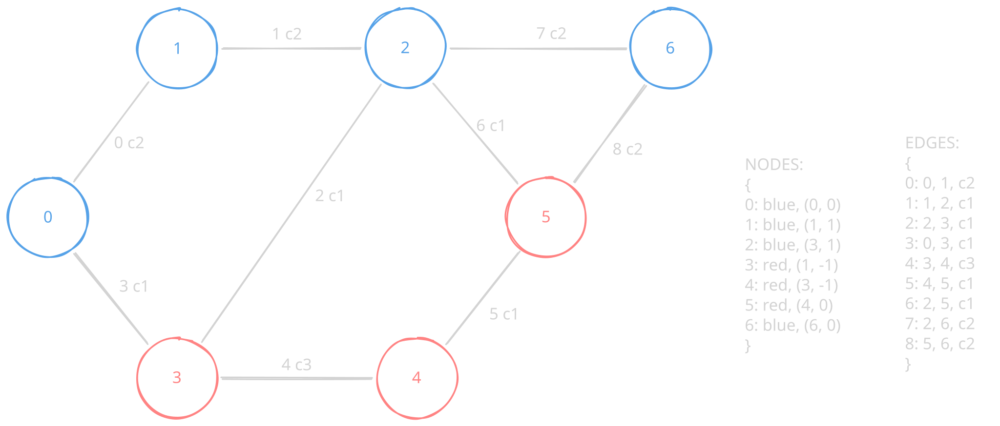

*This project has been created as part of the 42 curriculum by alvespin.*

# FLY-IN

    

 

## Table of Contents

1. [Description](#description)
2. [Intructions](#instructions)
3. [Resources](#resources)

---

## Description

...

---
## Instructions

...

---
## Resources

#### Guides

- [Introduction to Graphs in Python](#https://www.geeksforgeeks.org/python/introduction-to-graphs-in-python/)

#### Documentation

- [Dijkstra's_algorithm](#https://en.wikipedia.org/wiki/Dijkstra%27s_algorithm)
- [uv documentation](https://docs.astral.sh/uv/)

#### Projects

- [Fly-in by megyant](#https://github.com/megyant/42_Fly-in)
- [Fly-in by fjose-hi](#https://github.com/felipehillebrand-ops/Fly-in)
- [Fly-in by yelgoumr](#https://github.com/ELGOUMRIYASSINE/fly-in)
