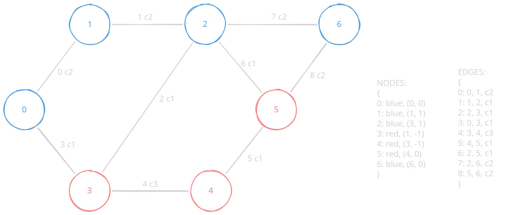

*This project has been created as part of the 42 curriculum by alvespin.*

# FLY-IN

<div align="center">
    
</div>
<br>


## Table of Contents

1. [Description](#description)
2. [Intructions](#instructions)
3. [Resources](#resources)


## Description

...

#### Pathfinding limitations

- **Blocked zones**: nodes marked with this zonetype are excluded from the adjancency list before pathfinding starts, thus preventing them from being used in the algorithm.

- **Priority zones**: nodes marked with this zonetype are checked during pathfinding and assigned as the parent of a node when appropiate.

- **Restricted zones**: nodes marked with this zonetype make the drone travelling towards it wait for a turn, i.e.: it doesn't move to the next node until the drone tries to move again in the following turn. This is achieved with a specific attribute that is set during the first turn and checked at the beginning of the second. Additionally, their presence will make a path less likely to be assigned to a drone.

#### Benchmarks

<table>
    <tr>
        <td></td><td rowspan=2 colspan=2>Map name</td><td rowspan=2>Shortest path (nodes)</td><td>Best result (turns)</td><td>Best result (turns)</td>
    </tr>
    <tr>
        <td></td><td>Single path</td><td>Multiple paths</td>
    </tr>
    <tr>
        <td>0</td><td rowspan=3>easy</td><td>01_linear_path.txt</td><td>4</td><td>4</td><td>4</td>
    </tr>
    <tr>
        <td>1</td><td>02_simple_fork.txt</td><td>4</td><td>5</td><td>6</td>
    </tr>
    <tr>
        <td>2</td><td>03_basic_capacity.txt</td><td>4</td><td>4</td><td>4</td>
    </tr>
    <tr>
        <td>3</td><td rowspan=3>medium</td><td>01_dead_end_trap.txt</td><td>5</td><td>8</td><td>8</td>
    </tr>
    <tr>
        <td>4</td><td>02_circular_loop.txt</td><td>5</td><td>15</td><td>15</td>
    </tr>
    <tr>
        <td>5</td><td>03_priority_puzzle.txt</td><td>5</td><td>7</td><td>8</td>
    </tr>
    <tr>
        <td>6</td><td rowspan=3>hard</td><td>01_maze_nightmare.txt</td><td>7</td><td>14</td><td>13</td>
    </tr>
    <tr>
        <td>7</td><td>02_capacity_hell.txt</td><td>6</td><td>13</td><td>16</td>
    </tr>
    <tr>
        <td>8</td><td>03_ultimate_challenge.txt</td><td>13</td><td>32</td><td>26</td>
    </tr>
    <tr>
        <td>9</td><td>challenger</td><td>01_the_impossible_dream.txt</td><td>16</td><td>90</td><td>91</td>
    </tr>
</table>

## Instructions

```bash
make run
```

The command has the following flags:
    --map_file N    Select a specific map file (1,9).
    --log           Show all the paths found and assigned.


```bash
make run ARGS="--map_file=5 --log"
```

## Resources

#### Guides

- [Introduction to Graphs in Python](https://www.geeksforgeeks.org/python/introduction-to-graphs-in-python/)
- [Breadth First Search for a Graph in Python](https://www.geeksforgeeks.org/python/python-program-for-breadth-first-search-or-bfs-for-a-graph/)

#### Documentation

- [uv documentation](https://docs.astral.sh/uv/)
- [Dijkstra's_algorithm](https://en.wikipedia.org/wiki/Dijkstra%27s_algorithm/)
- [Difference Between List and Tuple in Python](https://www.geeksforgeeks.org/python/python-difference-between-list-and-tuple/)

#### Projects

- [Fly-in by megyant](https://github.com/megyant/42_Fly-in)

#### IA

The AI chatbot Claude was used to resolve incedental problems and unexpected results. No code was provided.


# TODO

• A detailed description of your algorithm choices and implementation strategy must
also be included.
• Documentation of the visual representation features and how they enhance the user
experience.
• Example input and expected output demonstrating the program’s functionality.
